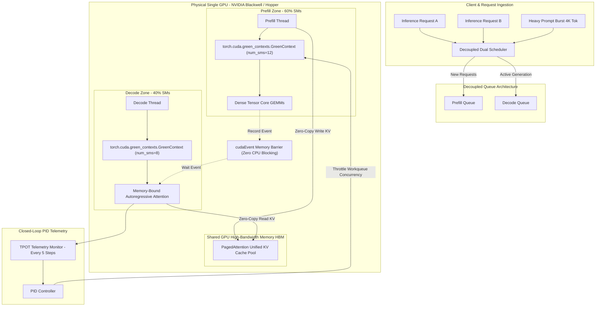
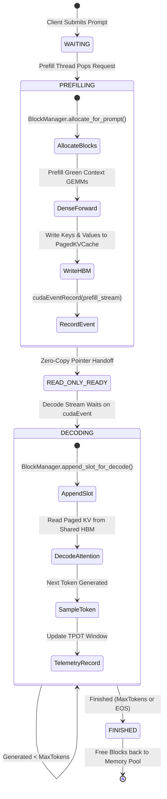

# Project GreenSpace: Single-GPU Spatial Prefill-Decode Disaggregation Engine
## Comprehensive Architectural Whitepaper & Systems Specification

---

## 1. Executive Summary: The Prefill-Decode Interference Crisis

In large language model (LLM) serving, inference consists of two fundamentally asymmetrical computational phases operating on the same physical processor:

$$\begin{aligned}
\text{\textbf{Prefill Phase (Prompt Ingestion)}} &: \text{Compute-bound}, \quad \mathcal{O}(S^2 \cdot D) \quad \text{saturating Tensor Cores with dense GEMMs} \\
\text{\textbf{Decode Phase (Token Generation)}} &: \text{Memory-bound}, \quad \mathcal{O}(S \cdot D) \quad \text{reading historical KV caches from HBM/L2}
\end{aligned}$$

In baseline inference engines (such as standard monolithic vLLM), both workloads share the same GPU execution stream and context. When a massive prompt (e.g., 8K to 30K tokens) arrives, the compute-heavy prefill kernel monopolizes all Streaming Multiprocessors (SMs), starving active decode streams and producing severe **Time-Per-Output-Token (TPOT) latency spikes** (from 20ms jumping past 400ms).

While cloud hyperscalers address this through **Multi-Node Disaggregation** (allocating separate GPU servers for Prefill and Decode and transferring the KV cache over RDMA/InfiniBand networks), that approach requires massive multi-node clusters, complex networking, and introduces **50–200ms of network KV-transfer latency**. It is completely unusable on single-GPU workstations, edge servers, or cost-constrained private enterprise deployments.

**Project GreenSpace** introduces **Intra-GPU Spatial Disaggregation**, physically slicing a single GPU's hardware into isolated execution zones using CUDA 13.4+ **Green Contexts**, achieving:
1. **Physical SM Isolation** (e.g., 60% SMs for Prefill, 40% SMs for Decode).
2. **Zero-Copy HBM Handoff** (0.0 ms network latency, instantaneous pointer exchange in shared GPU memory).
3. **Closed-Loop PID Bandwidth Throttling** (dynamically controlling workqueue concurrency to eliminate shared L2/HBM bus thrashing).

---

## 2. High-Level Architectural Workflow

---

## 3. The Three Foundational Pillars

### Pillar 1: Spatial SM Isolation via CUDA Green Contexts
Unlike standard CUDA contexts which multiplex all Streaming Multiprocessors across all active streams, CUDA Green Contexts (`cuGreenCtxCreate`) provision physical subsets of SMs at the driver level:

* **Compute Capability 9.0+ Granularity:** Slices must adhere to architectural minimums ($\ge 8$ SMs, co-scheduled alignment).
* **Guaranteed Compute Quotas:** The Prefill stream is strictly constrained to its 60% partition. Even during a 30,000-token prompt ingestion, it physically cannot schedule warps on the remaining 40% SMs dedicated to the Decode stream.
* **Deterministic Decoding:** Active users experience predictable, real-time token delivery regardless of incoming prompt volumes.

### Pillar 2: Zero-Copy HBM Handoff (0.0 ms Network Latency)
In multi-node disaggregated architectures (Splitwise, DistServe, Mooncake), transferring the KV cache of a 4K prompt across InfiniBand takes tens of milliseconds. In Project GreenSpace:
* Both Green Contexts inhabit the **exact same physical GPU**.
* The Paged KV cache blocks are allocated once in unified High-Bandwidth Memory (HBM).
* When the Prefill Thread finishes its forward pass, it records a `cudaEvent` on the prefill stream.
* The request transitions to `READ_ONLY_READY`, and the block table pointers are handed to the Decode Thread.
* The Decode stream executes an asynchronous, non-blocking `cudaStreamWaitEvent`.
* **Zero data is moved, zero bytes are copied over PCIe or network, and latency overhead is 0.0 ms.**

### Pillar 3: Closed-Loop PID Bandwidth Throttling
While Green Contexts isolate compute units (SMs), they share the memory bus and L2 cache. Unconstrained prefill GEMMs can saturate HBM memory channels, causing memory contention that degrades decode read throughput.

To eliminate this, GreenSpace integrates a **Closed-Loop PID Controller**:

$$\begin{aligned}
e(t) &= \text{TPOT}(t) - \text{TPOT}_{\text{target}} \\
u(t) &= K_p e(t) + K_i \int_0^t e(\tau) d\tau + K_d \frac{de(t)}{dt} \\
\text{WQ\_Limit}(t) &= \text{clamp}\left(\text{WQ}_{\text{nominal}} - \text{round}(u(t)), \;\; \text{WQ}_{\text{min}}, \;\; \text{WQ}_{\text{max}}\right)
\end{aligned}$$

When rolling TPOT exceeds the SLO target (e.g. 25ms), $e(t) > 0$. The controller immediately throttles the Prefill Green Context's `workqueue_concurrency_limit` and scales down the prefill micro-chunk size, restoring decode memory bandwidth priority within two feedback cycles.

---

## 4. State Machine & Synchronization Protocol

---

## 5. Elastic SM Rebalancing

When the decode queue is idle (no active client generations), maintaining an idle 40% SM partition would waste valuable compute. GreenSpace implements **Elastic SM Rebalancing**:
* When `num_active_decodes == 0`, the controller instantly expands prefill concurrency and workqueue bandwidth to 100% of the GPU.
* The moment a new token enters the decode queue, the controller instantaneously restores the nominal 60/40 partition, ensuring zero degradation for incoming decode traffic.

